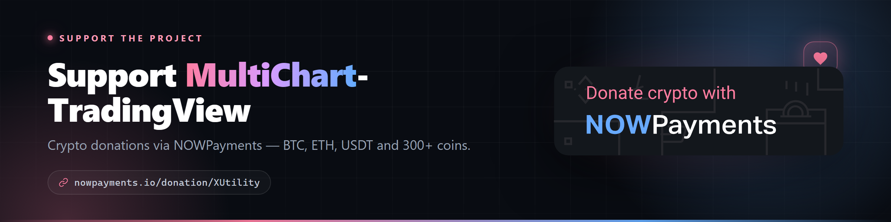

# MultiChart-TradingView 🚀
### Professional multi-chart TradingView desktop terminal
### ترمینال پیشرفته دسکتاپ چند چارته تریدینگ‌ویو با چیدمان اسپلیت و همگام‌سازی

[](https://github.com/XUtility/MultiChart-TradingView/releases/latest)
[](https://github.com/XUtility/MultiChart-TradingView/releases/latest)
[](LICENSE)
[](https://github.com/XUtility/MultiChart-TradingView/releases)
[](https://github.com/XUtility/MultiChart-TradingView/releases/latest)
[](https://nowpayments.io/donation/XUtility)


> **Source repository.** The application source lives here; the public download channel at [XUtility/MultiChart-TradingView](https://github.com/XUtility/MultiChart-TradingView) carries only this documentation, the [LICENSE](LICENSE), the demo GIF, the donation artwork and the release packages.

**Contents:** [English documentation](#-english-documentation) · [راهنمای فارسی](#-راهنمای-فارسی) · [Download](#-download--installation) · [Support](#-support-the-project) · [FAQ](#-frequently-asked-questions) · [License](#-license--copyright)

---

## 🌐 English Documentation

### 📌 Overview

**MultiChart-TradingView** is a standalone Windows desktop terminal for active traders and technical analysts. It puts many TradingView charts on one screen — up to a 16-pane grid in a single window — and keeps symbols, crosshairs and drawings in step, **without paid layout locks and without browser extensions**.

It is one native executable: a Rust/Tauri v2 shell on the outside, one WebView2 chart page per pane on the inside. Sign-in happens in a real TradingView page inside an isolated profile, so passkeys, OAuth and two-factor authentication work exactly as they do in a browser.

### 🆕 What's new in 1.3.15

* 🎯 **The synchronized crosshair holds still** — with Sync on, a pane that received a relayed point answered with that same point, that answer was relayed back, and every round trip landed on a truncated pixel, so the horizontal line climbed about 18 pixels a second while the pointer stayed put. Applied points are now rounded onto the pane's real pixel grid and a pane stays quiet for a moment after it receives one, so the crosshair sits exactly where the pointer is.
* 🗂️ **A trading desk: named workspaces, a settings backup and a visual journal** — the new **میز کار** button opens a Persian panel beside the charts. Save the current tab's layout and symbols under a name ("فارکس · سشن لندن") and bring it back later, export every layout, watchlist, workspace and look into one backup file and restore it only after seeing what the file contains, or keep a journal where each entry carries a PNG captured from a chart you pick, the entry price and stop, the outcome and your notes.
* 🧰 **The whole drawing catalogue in the rail** — the Persian tool palette now lists the pattern and Elliott tools (ABCD, Cypher, head-and-shoulders, three-drivers, impulse/correction/triangle/combo waves), Gann, pitchfork, Fibonacci time-zone, circles, spiral, wedge and the remaining Gann and projection tools beside the existing shapes.

*From 1.3.13:* the setup installs itself with one click.

### 🆕 What's new in 1.3.13

* ⏱️ **One-click setup — no wizard, no repeated Next** — the installer used to walk through welcome, license, install-location, "already installed" and finish pages, each waiting for a click. It now opens straight onto its progress window, installs for the current user where the previous copy lives, shows every step as it happens, creates the desktop and Start-menu shortcuts, launches the terminal and closes on its own. Only **Cancel** is left on the window.
* 🖤 **A progress window that belongs to the app** — the setup is painted in the terminal's dark palette: a blue accent progress bar on a dark track and a step log in the terminal's own colours, instead of the stock white dialog.

*From 1.3.12:* a chart pane that stops painting now heals itself within about half a minute.

### 🆕 What's new in 1.3.12

* 🩹 **A chart that went blank now heals itself** — Windows can stop a chart surface from painting after it is covered (another app, the terminal minimised, the monitor waking up) while the page keeps running, so the pane sat on a flat background and nothing brought it back. The terminal now reads the real pixels of every pane, and a pane that stays blank is rebuilt automatically within half a minute. Chromium's occlusion tracker is also switched off so the blanks happen far less often.

### 🆕 What's new in 1.3.11

* 🧲 **The magnet-mode and global-look buttons respond again** — both menus used to open *inside* the horizontally scrolling drawings bar, where the bar's overflow clipped them away, so clicking either icon looked like nothing happened. They now open as floating panels anchored under their button, above the toolbar and the chart, and stay fully clickable.
* 🚫 **Bottom-left promo cards close themselves** — TradingView's referral/ad card (a Google ad slot whose × lives in a cross-origin frame) is hidden automatically as soon as it appears, so it no longer covers the corner of the chart.
* 🪟 *From 1.3.10:* **A drawing settings panel that stays out of your way** — it opens beside the selected shape and its floating toolbar instead of covering them, can be dragged by its header, remembers that position for next time, and folds down to its title bar with one click. Double-click the header to snap it back to the automatic spot, `Ctrl+Enter` applies the changes and `Esc` closes only the panel.
* ↩️ **Undo and redo for every drawing action** — add, move, reshape, restyle, duplicate, lock, delete or clear; two new arrows in the drawing rail do it, or `Ctrl+Z` / `Ctrl+Y` (`Ctrl+Shift+Z`). Each symbol keeps the last 60 steps.
* ⧉ **Duplicate a drawing** from the floating toolbar or with `Ctrl+D` — the copy is offset two bars to the right and selected straight away.
* 🖥️ *From 1.3.9:* **Charts fill their pane on every monitor and scaling** — the native chart surface is now sized in real device pixels and re-measured after every layout, DPI or monitor change. On 19" screens, high-DPI displays and Windows "override high DPI scaling" setups the chart used to shrink into the top-left corner with dark space around it; it now always fills its pane exactly.
* 📐 **A master bar that fits narrow windows** — under 1990 px the right-hand actions collapse to icons, under 1400 px the bar takes a second row, and under 1000 px the extra labels disappear. No button is clipped or unreachable at 1280×720, 1366×768 or 1024×600.
* 🎨 *From 1.3.8:* **TradingView-style drawing tools in the replay studio** — select any drawing and a floating white toolbar appears above it, with the object's style, text, line width, dash, lock, delete and a full settings dialog. The settings dialog carries the four TradingView tabs — **Style**, **Text**, **Coordinates** and **Visibility** — so a line can be recoloured, given a price tag, extended, bent at its midpoint, labelled with a stats chip or hidden on chosen timeframes without ever leaving the chart.
* 🔵 **Real selection and resize handles** — TradingView blue rings on line and shape points, and eight handles on a rectangle (four corners plus four edge midpoints), each of which drags only the edge it belongs to.
* ✏️ **Per-drawing text and labels** — choose size, bold, italic, colour and alignment; price labels ride the right scale of every point; the stats chip shows price and percent move, green or red.
* 🔒 **Lock and per-timeframe visibility** — a locked drawing refuses to move, reshape or delete until you unlock it, and the Visibility tab decides which timeframes each drawing is shown on.
* ⏮️ *From 1.3.7:* **Backtest / bar replay** — pick a date and every later candle is covered with a veil the colour of your chart; step the frontier with `←` / `→`, one candle or 5 / 10 at a time. Single-chart only, and the price scale, legend and last-price tag are fitted to the revealed bars so the hidden future never leaks.

### ✨ Key features

#### 🖥️ One window, many charts
* Build the grid you need and keep your tabs, layout and charts exactly where you left them.
* Window size, position and maximised state are remembered; a monitor that is no longer attached falls back to the default placement.
* A tray icon keeps the terminal one click away, even when the window is minimised.

#### 🔀 48 split layouts, from one chart to a 16-pane grid
* 1, 2 (vertical / horizontal), 3 (rows, columns, dominant side, dominant top or bottom), 4 (grid, rows, columns, mixed), 5, 6, 7, 8, 9, 10, 12 and 16 panes.
* The layout picker lives in the master bar and shows a thumbnail of every arrangement; the button itself previews the active layout.
* Smooth draggable splitters; double-click a splitter to snap back to an even ratio.

#### 👤 Up to 8 isolated TradingView accounts
* Every tab runs in one of eight separate browser profiles (`acc_1`…`acc_8`), each with its own WebView2 data folder — sessions, layouts and drawings never leak between accounts.
* Tabs that share a profile may stay open together: only the visible tab keeps its chart connections alive, and background tabs of that profile are reopened when you switch back. This keeps one account under TradingView's concurrent-tab limit.
* If TradingView still shows its multi-tab / plan-limit dialog, the terminal dismisses it automatically and releases the profile's background tabs instead of clicking **Restore connection**, which would steal the session from the visible chart.
* The **Accounts** button opens the profile grid; each profile has its own sign-in window and shows the TradingView account it is signed in as (or **Open sign-in** if not yet).
* **Hide names** in the Accounts header replaces every username with dots and drops its tooltip — useful when sharing your screen; the setting is remembered.
* Click a tab's `[A#]` badge to move it to another profile, then **Reload charts** to pick up that profile's session.
* Switch tabs with `Ctrl+Tab` or `Ctrl+1`…`Ctrl+9`, open a new one with `Ctrl+T`, close with `Ctrl+W`.

#### 🛠️ Floating, customisable drawing master bar
* One shared toolbar for your favourite drawing tools — trend line, horizontal line, arrow marks, fib retracement, brush, text, gann box, long/short position and more.
* Choose exactly which tools the bar shows so it stays short, and set the magnet mode from the same bar.
* A tool armed from the master bar belongs to the tab you clicked it on and to the one drawing you are making — it does not follow you across every chart.

#### 🎨 Global look & shared templates
* Open the palette button in the master bar to choose the **source account** (`All` or `A1`…`A8`).
* **Sync chart appearance** copies the source chart's background, grid, scales and candle colours to every linked chart; the source account keeps its own look and keeps reporting changes.
* Apply a template from TradingView's **Templates** menu on the source account and it appears in the global-look menu, grouped by tool. One click makes it the style for new drawings in the active tab.
* Captured templates are stored locally and can be applied across accounts, so a style you built on one profile is available on all of them.

#### 🔍 Live symbol search and watchlist
* Type a ticker and get results from every connected broker and exchange, each badged with its venue (Binance, OANDA, FXCM, CME, Bitstamp, Vantage…).
* Apply a symbol to all linked charts in one click, with a persistent watchlist for fast switching.

#### 📊 Chart clarity controls
* **Symbol** sync and **Crosshair** sync toggles, **Chart Info**, **Sync** (`Ctrl+S`, save and sync drawings to the TradingView cloud), **Drawings** (show or hide the left drawing toolbar), **Max Space** (strips TradingView chrome so the candles own the screen), **Legend** (show or hide indicator values on every chart).
* Crosshair sync mirrors the pointer across every chart in the active tab by **bar time and price**, not by screen pixels, so panes with different timeframes, sizes or zoom levels stay aligned. Same-symbol panes share the price line; a different symbol gets the time line only. It pauses while a drawing tool is armed, stays off for maximized panes, and the **Crosshair** button turns it off for everyone.
* **Per-pane maximize** — `Alt+Enter`, `Alt+click` on a chart, or TradingView's own fullscreen button grows that pane over its siblings and restores it again.

#### ⏮️ Backtest / bar replay
* Pick a date in the **Backtest** panel; every later candle is covered by a veil painted in the chart's own background colour.
* `←` / `→` step the frontier back or forward — one candle at a time, or switch the step to 5 or 10.
* The compact readout tracks the frontier bar's local time and OHLC, plus how many candles are revealed and hidden; `Esc` ends the run and restores the chart exactly as it was.
* The run is single-chart only, so a veil is never broadcast to sibling panes. The price scale, legend, price line, countdown and last-price tag are hidden and fitted to the revealed bars, so the veiled future never leaks through the axis.

**How far back can I go?** The replay covers the candles the chart already holds, and TradingView decides how much history a chart may load — that limit comes from your plan, not from the terminal. Measured on a free (non-Pro) account on `OANDA:GBPUSD` in November 2026:

| Timeframe | Oldest candle | Bars available |
| :--- | :--- | ---: |
| `1m` | 2026-10-25 (~10 days) | 11,017 |
| `5m` | 2026-10-11 (~24 days) | 5,094 |
| `15m` | 2026-08-02 (~3 months) | 6,498 |
| `1h` | 2026-01-01 (~10 months) | 5,249 |
| `4h` | 2023-01-01 (~2.8 years) | 5,981 |
| `1D` | 2002-05-05 (start of the symbol) | 6,365 |
| `1W` | 2002-05-05 (start of the symbol) | 1,279 |

In short: a free plan gives a couple of weeks of 1-minute data and about ten months of hourly data, while daily and weekly candles reach the symbol's full history. Scroll the chart back towards older candles before opening the Backtest panel so it can offer those dates, or switch to a higher timeframe for older ranges. A paid TradingView plan or another venue can expose more; the terminal never works around TradingView's limits.

#### 🔄 In-app updates
* The **Update** button checks the newest GitHub release against the version you are running and flags itself when something newer exists.
* It lists the packages for this platform — installer, MSI or portable zip — with their size and whether a checksum was published, and downloads with a live progress bar.
* **Nothing is downloaded without a published SHA-256, and nothing is executed until the hash of the file on disk matches it**; a mismatch deletes the file and says so. When you are already on the newest release the panel simply says so.

#### 🔐 Accounts and persistence
* Sign-in happens in a real TradingView page inside a dedicated profile, so passkeys, OAuth and two-factor all work the way TradingView expects. The profile's account name is reported back to the Accounts grid and can be masked with **Hide names**.
* Drawings, indicators, templates and chart settings persist per account, because they belong to the profile's own session.
* Window placement, tabs, layouts and the global-look source are remembered by the terminal itself.

#### 🛡️ Locked-down surface
* Chart pages can only talk to the terminal through a one-way `document.title` channel; they hold no IPC permission, so a page cannot call into the shell.
* Pop-ups and `window.open` calls never open inside the terminal — they go to your default browser.
* Symbol and timeframe input is validated before it reaches a chart, and the tab/layout identifiers sent to the native chart layer come from a fixed, checked set.

#### ⚡ Clean by default
* No sidebars, no promotional banners, no bottom clutter — the screen belongs to the charts.

### 🏗️ How it works

| Layer | What it does |
| :--- | :--- |
| **Shell** | Rust + Tauri v2 window, layout engine, master bar, tabs, updater, tray |
| **Chart pane** | One native WebView2 child per pane, loading TradingView with its own profile |
| **Profiles** | Eight isolated WebView2 data folders (`acc_1`…`acc_8`) |
| **Bridge** | Charts report to the shell through `document.title`; the shell drives charts through a validated eval channel |
| **Storage** | TradingView session data inside each profile; terminal settings and captured templates under your Windows user profile |

The terminal collects no telemetry of its own. The charts inside it are TradingView pages and behave like TradingView in a browser.

### ⌨️ Keyboard shortcuts

| Shortcut | Action |
| :--- | :--- |
| `Ctrl + T` / `Ctrl + W` | New account tab / close the current tab |
| `Ctrl + Tab` | Cycle between account tabs |
| `Ctrl + 1` … `Ctrl + 9` | Jump straight to a tab |
| `Ctrl + S` | Save drawings to the TradingView cloud account |
| `←` / `→` | Backtest: hide or reveal the next candle (or 5 / 10 steps) |
| `F11` | Toggle fullscreen |
| `Alt + Enter` / `Alt + click pane` | Maximize or restore that chart pane |
| `Enter` (in search) | Apply the symbol to all linked charts |
| `Esc` | Close the open menu, panel or backtest |
| `Double-click splitter` | Reset that divider to an even ratio |

### ⚡ Performance & specifications

| | |
| :--- | :--- |
| **Distribution** | One portable ZIP or installer — no admin rights needed for the portable build |
| **Terminal process** | A few tens of MB of its own memory, independent of chart count |
| **Per chart** | ~250 MB — that is TradingView's own web runtime, not the terminal |
| **Startup** | Under half a second to the first chart |
| **Architecture** | Rust + Tauri v2, one WebView2 page per chart pane |
| **Requires** | Windows 10 or 11, x64, with the WebView2 runtime (shipped with Windows 11 and current Windows 10) |

### 📥 Download & installation

1. Open the [Releases](https://github.com/XUtility/MultiChart-TradingView/releases/latest) page and download from the newest release.
2. Pick one of:
   * `MultiChart-TradingView-<version>-Portable.zip` — unzip anywhere and run `MultiChart-TradingView.exe`.
   * `MultiChart-TradingView_<version>_x64-setup.exe` — NSIS installer (per-user, no elevation prompt).
   * `MultiChart-TradingView_<version>_x64_en-US.msi` — MSI for managed machines.
3. Verify the download if you wish:

```powershell
Get-FileHash .\MultiChart-TradingView-1.3.15-Portable.zip -Algorithm SHA256
# compare with the matching line in SHA256SUMS.txt
```

4. From then on, keep the terminal current with the **Update** button inside the app.

Every release publishes `SHA256SUMS.txt` next to the packages; the updater refuses to download a package that has no checksum and re-verifies the file on disk before launching it.

*Sign-in, layouts and drawings are stored under your Windows user profile, so the same account state is reused by the portable and the installed build.*

### ❓ Frequently asked questions

**Where is the source code?**
This repository is the public download channel. The application source is proprietary and is not published here; the repository contains documentation, the license and the demo GIF only.

**Do I need a paid TradingView plan?**
The terminal arranges charts with its own layout engine, so many charts can share one window. Your TradingView account and plan still govern what TradingView itself allows (data, indicators, alerts, simultaneous sessions). The terminal is not affiliated with TradingView and does not bypass their terms.

**How many accounts can I use?**
Up to eight isolated profiles. Each profile signs in separately and keeps its own session and data. TradingView's own plan limits still apply to each account.

**Does the terminal see my password?**
No. Sign-in happens in a genuine TradingView page inside the profile, and the terminal does not read or store credentials. Sessions live in that profile's WebView2 data folder under your Windows user profile.

**Does it send telemetry?**
The terminal itself collects none. The embedded TradingView pages behave as TradingView does in a browser.

**Why does one chart use around 250 MB?**
That is TradingView's web runtime per chart page, not the terminal shell. The shell stays in the tens of MB no matter how many panes you open.

**Windows shows a SmartScreen warning — is that expected?**
The executable may not be code-signed. Verify the SHA-256 against `SHA256SUMS.txt` first; if it matches, use **More info → Run anyway**. Never run a package whose hash does not match.

**My antivirus quarantined the installer — what should I do?**
A self-extracting installer that was just published and has not been seen much yet can trip heuristic detections even though it is harmless. Do not skip verification: compare the file's SHA-256 with `SHA256SUMS.txt`, and restore it from quarantine only when they match. Then report the false positive together with the file and its hash — for Microsoft Defender at [microsoft.com/wdsi/filesubmission](https://www.microsoft.com/en-us/wdsi/filesubmission); these reports are normally cleared within a day or two. If your product keeps blocking the installer, use the Portable ZIP instead.

**Does it run on macOS or Linux?**
No. It requires Windows 10/11 x64 and the WebView2 runtime.

### 💖 Support the project

[](https://nowpayments.io/donation/XUtility)

If MultiChart saves you time, you can support its development with crypto. Donations are handled by **NOWPayments** — BTC, ETH, USDT and 300+ coins. The pink heart in the app's master bar opens the same page in your browser.

**Donation page:** [nowpayments.io/donation/XUtility](https://nowpayments.io/donation/XUtility)

### ⚠️ Disclaimer

TradingView is a trademark of TradingView, Inc. This project is not affiliated with, endorsed by or sponsored by TradingView. Trading involves substantial risk; this software is a window-management tool, not investment advice. Use it at your own risk and in accordance with TradingView's terms of service.

---

## 🇮🇷 راهنمای فارسی

### 📌 معرفی

**MultiChart-TradingView** یک ترمینال دسکتاپ مستقل و سریع برای ویندوز است که چندین چارت تریدینگ‌ویو را روی یک صفحه می‌چیند و نماد، کراسهیر و رسم‌ها را بین چارت‌ها هماهنگ نگه می‌دارد — **بدون قفل چیدمان پولی و بدون هیچ اکستنشن مرورگر**. خروجی برنامه یک فایل اجرایی نیتیو است: بدنه با Rust/Tauri v2 و هر چارت در یک WebView2 مستقل.

ورود به حساب در یک صفحه واقعی تریدینگ‌ویو داخل پروفایل اختصاصی انجام می‌شود، پس OAuth، پس‌کی و ورود دومرحله‌ای همان‌طور که تریدینگ‌ویو انتظار دارد کار می‌کند.

> **این ریپو فقط کانال دانلود و مستندات است.** سورس برنامه در اینجا منتشر نمی‌شود؛ فایل‌های نصبی در بخش [Releases](https://github.com/XUtility/MultiChart-TradingView/releases/latest) قرار دارند.

### 🆕 تازه در نسخه ۱.۳.۱۳

* ⏱️ **ستاپ یک‌کلیکی — بدون ویزارد و بدون Nextهای تکراری:** نصب‌کننده قبلاً صفحه‌های خوش‌آمد، لایسنس، مسیر نصب، «قبلاً نصب شده» و پایان را یکی‌یکی نشان می‌داد و هر کدام یک کلیک می‌خواست. حالا مستقیم روی پنجرهٔ پیشرفت باز می‌شود، همان‌جایی که نسخهٔ قبلی نصب بوده نصب می‌کند، هر مرحله را همان لحظه نشان می‌دهد، شورتکات دسکتاپ و منوی استارت را می‌سازد، ترمینال را باز می‌کند و خودش بسته می‌شود. از دکمه‌ها فقط **Cancel** مانده است.
* 🖤 **پنجرهٔ پیشرفتی هم‌رنگ خود برنامه:** ستاپ با پالت تیرهٔ ترمینال کشیده می‌شود — نوار پیشرفت آبی روی زمینهٔ تیره و لاگ مراحل با رنگ‌های خود برنامه، به‌جای دیالوگ سفید پیش‌فرض ویندوز.

*از نسخهٔ ۱.۳.۱۲:* پنل چارتی که نقاشی‌اش متوقف شود ظرف حدوداً نیم دقیقه خودش درمان می‌شود.

### 🆕 تازه در نسخه ۱.۳.۱۲

* 🩹 **چارتِ سیاه‌شده خودش درمان می‌شود:** ویندوز می‌تواند نقاشی یک سطح چارت را بعد از پوشیده‌شدن (باز شدن برنامه‌ای دیگر، مینیمایز شدن ترمینال، بیدار شدن مانیتور) متوقف کند، در حالی که صفحه هنوز زنده است؛ نتیجه‌اش پنلی بود که روی یک پس‌زمینه یکدست می‌ماند و هیچ‌چیز آن را برنمی‌گرداند. حالا ترمینال پیکسل واقعی هر پنل را می‌خواند و پنلی که سیاه بماند ظرف نیم دقیقه خودکار بازسازی می‌شود. ردیاب اشغال‌شدن پنجره در Chromium هم خاموش شده تا این اتفاق خیلی کمتر بیفتد.

### 🆕 تازه در نسخه ۱.۳.۱۱

* 🧲 **دکمهٔ مگنت و ظاهر سراسری دوباره جواب می‌دهند:** منوی این دو دکمه داخل نوار ابزارِ افقی‌اسکرول‌شونده باز می‌شد و همان نوار آن را می‌برید؛ برای همین کلیک روی آیکن‌ها بی‌اثر به نظر می‌رسید. حالا منو به‌صورت شناور زیر دکمه، بالای نوار ابزار و چارت باز می‌شود و کامل قابل کلیک است.
* 🚫 **کارت تبلیغاتی پایین-چپ چارت خودکار بسته می‌شود:** کارت دعوت/تبلیغ تریدینگ‌ویو (یک اسلات تبلیغاتی گوگل که دکمهٔ × آن داخل iframe جداافتاده است) بلافاصله پنهان می‌شود و دیگر گوشهٔ چارت را نمی‌پوشاند.
* 🪟 *از نسخه ۱.۳.۱۰:* **پنجرهٔ تنظیمات رسم دیگر روی کار شما نمی‌افتد:** کنار خود شکل و نوار ابزار شناورش باز می‌شود، با کشیدن هدر جابه‌جا می‌شود، جای آن برای بار بعد ذخیره می‌شود و با یک کلیک تا نوار عنوان جمع می‌شود. دوبار کلیک روی هدر آن را به جای خودکار برمی‌گرداند، `Ctrl+Enter` تغییرات را تأیید می‌کند و `Esc` فقط همین پنجره را می‌بندد.
* ↩️ **واگرد و ازنو برای همهٔ کارهای رسم:** ساخت، جابه‌جایی، تغییر شکل، تغییر سبک، تکثیر، قفل، حذف و پاک‌کردن؛ یا با دو فلش جدید در نوار ابزار ترسیم یا با `Ctrl+Z` / `Ctrl+Y` (`Ctrl+Shift+Z`). برای هر نماد ۶۰ مرحله نگه داشته می‌شود.
* ⧉ **تکثیر رسم** از نوار ابزار شناور یا با `Ctrl+D` — نسخهٔ کپی دو کندل جلوتر قرار می‌گیرد و همان لحظه انتخاب می‌شود.
* 🖥️ *از نسخه ۱.۳.۹:* **چارت روی هر مانیتور و هر مقیاسی اندازه کامل می‌گیرد:** سطح چارت نیتیو حالا بر اساس پیکسل واقعی دستگاه اندازه‌گیری می‌شود و بعد از هر تغییر چیدمان، DPI یا مانیتور دوباره محاسبه می‌شود. روی مانیتورهای ۱۹ اینچ، نمایشگرهای با مقیاس بالا و ویندوزهایی که گزینه «Override high DPI scaling» روشن دارند، قبلاً چارت کوچک می‌شد و گوشه بالا-چپ می‌ماند و اطرافش فضای تیره دیده می‌شد؛ حالا همیشه دقیقاً کل پنل خودش را پر می‌کند.
* 📐 **نوار ابزار روی پنجره‌های باریک جا می‌شود:** زیر ۱۹۹۰ پیکسل دکمه‌های سمت راست آیکونی می‌شوند، زیر ۱۴۰۰ پیکسل نوار دو ردیفه می‌شود و زیر ۱۰۰۰ پیکسل برچسب‌های اضافی حذف می‌شوند. در ۱۲۸۰×۷۲۰، ۱۳۶۶×۷۶۸ و ۱۰۲۴×۶۰۰ هیچ دکمه‌ای بریده یا غیرقابل‌کلیک نمی‌ماند.
* 🎨 *از نسخه ۱.۳.۸:* **ابزارهای رسم مثل خود تریدینگ‌ویو:** روی هر رسم کلیک کنید تا نوار ابزار شناور سفید بالای آن باز شود — استایل، متن، ضخامت خط، نوع خط، قفل، حذف و پنجره تنظیمات کامل. پنجره تنظیمات همان چهار تب تریدینگ‌ویو را دارد: **Style**، **Text**، **Coordinates** و **Visibility**؛ پس رنگ، برچسب قیمت، امتداد خط، خم شدن از نقطه میانی، چیپ آمار حرکت و مخفی‌کردن رسم روی تایم‌فریم‌های دلخواه همه از روی خود چارت انجام می‌شود.
* 🔵 **دستگیره‌های انتخاب و تغییر اندازه واقعی:** حلقه‌های آبی تریدینگ‌ویو روی نقاط خطوط و شکل‌ها، و هشت دستگیره روی مستطیل (چهار گوشه و چهار وسط ضلع) که هر کدام فقط همان ضلع را جابه‌جا می‌کند.
* ✏️ **متن و برچسب برای هر رسم:** اندازه، بولد، ایتالیک، رنگ و تراز؛ برچسب قیمت روی مقیاس راست هر نقطه؛ چیپ آمار با قیمت و درصد حرکت، سبز یا قرمز.
* 🔒 **قفل و نمایش بر اساس تایم‌فریم:** رسم قفل‌شده تا باز نشود جابه‌جا، تغییر شکل یا حذف نمی‌شود، و تب Visibility تعیین می‌کند هر رسم روی کدام تایم‌فریم‌ها دیده شود.
* ⏮️ *از نسخه ۱.۳.۷:* **بک‌تست / پخش مجدد کندل** — تاریخ را انتخاب می‌کنید و همه کندل‌های بعد از آن با پرده‌ای هم‌رنگ پس‌زمینه چارت پوشیده می‌شوند؛ با `←` / `→` مرز را جلو یا عقب می‌برید — یک کندل یا ۵ / ۱۰ کندل. فقط در چیدمان تک‌چارت و مقیاس قیمت، لجند و تگ قیمت آخر به کندل‌های آشکار محدود می‌شوند تا آینده مخفی لو نرود.

### ✨ قابلیت‌های کلیدی

* 🖥️ **یک پنجره، چندین چارت:** شبکه چارت دلخواهت را بساز و تب‌ها، چیدمان و چارت‌ها را همان‌طور که رها کردی برگردان. اندازه و موقعیت پنجره بعد از بستن به یاد می‌ماند و آیکون سینی (Tray) ترمینال را همیشه در دسترس نگه می‌دارد.
* 🔀 **۴۸ چیدمان، از تک‌چارت تا گرید ۱۶ خانه‌ای:** ۱، ۲ (عمودی/افقی)، ۳، ۴، ۵، ۶، ۷، ۸، ۹، ۱۰، ۱۲ و ۱۶ چارت با پیش‌نمایش بصری در نوار بالا؛ خطوط تقسیم قابل کشیدن و با دابل‌کلیک روی حالت برابر برمی‌گردند.
* 👤 **تا ۸ حساب تریدینگ‌ویو مستقل:** هر تب در یکی از هشت پروفایل (`acc_1` تا `acc_8`) اجرا می‌شود و هر پروفایل پوشه داده WebView2 خودش را دارد؛ نشست، چیدمان و رسم‌ها بین حساب‌ها قاطی نمی‌شود. تب‌هایی که یک پروفایل دارند می‌توانند کنار هم باز بمانند: فقط تب فعال اتصال چارت‌ها را نگه می‌دارد و تب‌های پس‌زمینه همان پروفایل هنگام برگشتن دوباره باز می‌شوند، تا یک حساب از محدودیت چند تب تریدینگ‌ویو رد نشود. اگر باز هم پنجره محدودیت پلن ظاهر شد، خودکار بسته می‌شود و تب‌های پس‌زمینه آزاد می‌شوند (به‌جای زدن دکمه Restore connection که اتصال را از چارت مقابل می‌قاپد). دکمه **Accounts** شبکه پروفایل‌ها را باز می‌کند؛ هر پروفایل پنجره ورود مستقل خودش را دارد و نام کاربری حساب همان پروفایل را نشان می‌دهد (یا دکمه **Open sign-in** اگر هنوز وارد نشده). دکمه **Hide names** در سربرگ، همه نام‌ها را با نقطه جایگزین و تولتیپ را حذف می‌کند و انتخابش ذخیره می‌شود. با کلیک روی نشان `[A#]` هر تب، آن تب را به پروفایل دیگری ببرید و سپس **Reload charts** بزنید.
* 🛠️ **نوار ابزار رسم شناور و شخصی‌سازی‌شدنی:** خط روند، افقی، پیکان، فیبوناچی، براش، متن، گن باکس و پوزیشن معاملاتی؛ فقط ابزارهای مورد علاقه‌تان را روی نوار نگه دارید و حالت آهنربا را از همان نوار انتخاب کنید. ابزاری که انتخاب می‌کنید فقط به همان تب و همان رسم مربوط است و به بقیه چارت‌ها سرایت نمی‌کند.
* 🎨 **ظاهر سراسری و قالب‌های مشترک:** از دکمه پالت در نوار ابزار، حساب منبع را انتخاب کنید. گزینه **Sync chart appearance** پس‌زمینه، گرید، مقیاس‌ها و رنگ کندل‌ها را به همه چارت‌های متصل می‌برد؛ حساب منبع ظاهر خودش را نگه می‌دارد. قالب‌هایی که روی حساب منبع در منوی Templates تریدینگ‌ویو ذخیره می‌کنید در همین منو ظاهر می‌شوند و با یک کلیک استایل رسم‌های جدید در تب فعال می‌شوند.
* 🔍 **جستجوی زنده نماد + واچ‌لیست:** نتایج همه بروکرها و صرافی‌ها با برچسب نام آن‌ها، و اعمال نماد روی همه چارت‌های متصل با یک کلیک.
* 📊 **دکمه‌های نمایش روی نوار بالا:** Symbol، Crosshair (همگام‌سازی نشانگر بین چارت‌ها)، Chart Info، Sync (`Ctrl+S` برای ذخیره و همگام‌سازی رسم‌ها در فضای ابری)، Drawings (نمایش/مخفی‌سازی نوار ابزار رسم سمت چپ)، Max Space (حذف تمام عناصر اضافی تریدینگ‌ویو) و Legend (نمایش/مخفی‌سازی مقادیر اندیکاتورها).
* 🎯 **همگام‌سازی کراسهیر بین چارت‌ها:** نشانگر موس بر اساس **زمان کندل و قیمت** (نه پیکسل صفحه) بین چارت‌های تب فعال منتقل می‌شود، پس با تایم‌فریم، اندازه و زوم متفاوت هم دقیق می‌ماند. چارت‌های هم‌نماد خط قیمت را هم نشان می‌دهند و نماد متفاوت فقط خط زمان را می‌گیرد؛ هنگام انتخاب ابزار رسم متوقف می‌شود و با دکمه **Crosshair** خاموش/روشن می‌شود.
* ⛶ **بزرگ‌کردن تکی پنل:** با `Alt+Enter`، `Alt+کلیک` روی چارت یا دکمه fullscreen خود تریدینگ‌ویو، آن پنل روی بقیه باز می‌شود و دوباره برمی‌گردد.
* ⏮️ **بک‌تست (پخش مجدد کندل):** از دکمه **Backtest** در نوار بالا تاریخ را انتخاب کنید؛ کندل‌های بعد از آن با پرده‌ای هم‌رنگ پس‌زمینه چارت پوشیده می‌شوند. با `←` / `→` یک‌یکی (یا ۵ و ۱۰ تایی) جلو بروید، زمان و OHLC هر کندل را ببینید و با `Esc` خارج شوید. فقط در چیدمان تک‌چارت، و مقیاس قیمت هم به کندل‌های آشکار محدود می‌شود تا سقف/کف آینده لو نرود.
* 🎨 **رسم حرفه‌ای در بک‌تست:** خط روند، مستطیل، فیبوناچی، پوزیشن لانگ/شورت، براش و متن با دستگیره‌های آبی انتخاب و تغییر اندازه، نوار شناور تنظیمات، برچسب قیمت، چیپ آمار، قفل و نمایش بر اساس تایم‌فریم — رسم‌ها روی نماد ذخیره می‌شوند و بعد از باز کردن دوباره همان‌جا هستند.
* 🔄 **آپدیت از داخل برنامه:** دکمه Update آخرین ریلیز گیت‌هاب را با نسخه فعلی مقایسه می‌کند و بسته مناسب را با نوار پیشرفت دانلود می‌کند. **بسته‌ای که چک‌سام SHA-256 منتشرشده نداشته باشد اصلاً دانلود نمی‌شود، و فایل دانلودشده تا وقتی هش آن روی دیسک با چک‌سام مطابقت نکند اجرا نمی‌شود**؛ اگر به‌روز باشید همین را اعلام می‌کند.
* 🔐 **ورود به حساب و ماندگاری:** ورود در صفحه واقعی تریدینگ‌ویو داخل هر پروفایل انجام می‌شود و نام حساب همان پروفایل به شبکه Accounts گزارش می‌شود (قابل پنهان‌سازی با **Hide names**)؛ رسم‌ها، اندیکاتورها، قالب‌ها و تنظیمات هر حساب در همان نشست پروفایل باقی می‌ماند. ترمینال خودش هیچ تله‌متری جمع نمی‌کند؛ چارت‌های داخل آن صفحات تریدینگ‌ویو هستند و مثل مرورگر رفتار می‌کنند.
* 🛡️ **سطح تماس محدود:** صفحه چارت‌ها فقط از طریق کانال یک‌طرفه `document.title` با ترمینال حرف می‌زنند و هیچ دسترسی IPC ندارند؛ پس یک صفحه نمی‌تواند به بدنه برنامه فرمان بدهد. پنجره‌های pop-up و `window.open` هرگز داخل ترمینال باز نمی‌شوند و به مرورگر پیش‌فرض می‌روند. ورودی نماد و تایم‌فریم قبل از رسیدن به چارت اعتبارسنجی می‌شود.
* ⚡ **محیط تمیز:** بدون سایدبار، تبلیغ و شلوغی — کل صفحه مال چارت‌هاست.

### ⏮️ تاریخچه داده برای بک‌تست

بک‌تست همان کندل‌هایی را نشان می‌دهد که چارت از قبل بارگذاری کرده، و مقدار تاریخچه‌ای که یک چارت می‌تواند لود کند را تریدینگ‌ویو بر اساس پلن شما تعیین می‌کند، نه ترمینال. اندازه‌گیری‌شده روی حساب رایگان (غیر Pro) با نماد `OANDA:GBPUSD` در نوامبر ۲۰۲۶:

| تایم‌فریم | قدیمی‌ترین کندل | تعداد کندل |
| :--- | :--- | ---: |
| `1m` | 2026-10-25 (حدود ۱۰ روز) | 11,017 |
| `5m` | 2026-10-11 (حدود ۲۴ روز) | 5,094 |
| `15m` | 2026-08-02 (حدود ۳ ماه) | 6,498 |
| `1h` | 2026-01-01 (حدود ۱۰ ماه) | 5,249 |
| `4h` | 2023-01-01 (حدود ۲.۸ سال) | 5,981 |
| `1D` | 2002-05-05 (شروع تاریخچه نماد) | 6,365 |
| `1W` | 2002-05-05 (شروع تاریخچه نماد) | 1,279 |

خلاصه اینکه در پلن رایگان از تایم‌فریم ۱ دقیقه حدود دو هفته و از ۱ ساعته حدود ده ماه عقب‌تر نمی‌روید، اما کندل‌های روزانه و هفتگی تا ابتدای تاریخچه نماد می‌رسند. برای بازه‌های قدیمی‌تر، پیش از باز کردن پنل بک‌تست چارت را به سمت کندل‌های قدیمی‌تر اسکرول کنید تا داده بیشتری لود شود، یا تایم‌فریم بالاتری انتخاب کنید. پلن پولی تریدینگ‌ویو یا بروکر دیگر می‌تواند تاریخچه بیشتری بدهد؛ ترمینال هیچ‌وقت محدودیت‌های تریدینگ‌ویو را دور نمی‌زند.

### ⌨️ کلیدهای میانبر

| میانبر | عملکرد |
| :--- | :--- |
| `Ctrl + T` / `Ctrl + W` | تب حساب جدید / بستن تب فعلی |
| `Ctrl + Tab` | جابه‌جایی بین تب‌های حساب |
| `Ctrl + 1` … `Ctrl + 9` | پرش مستقیم به تب شماره‌دار |
| `Ctrl + S` | ذخیره رسم‌ها در فضای ابری تریدینگ‌ویو |
| `←` / `→` | بک‌تست: مخفی/آشکار کردن کندل بعدی (یا ۵ / ۱۰ تایی) |
| `F11` | تمام‌صفحه |
| `Alt + Enter` / `Alt + کلیک روی پنل` | بزرگ‌کردن یا بازگرداندن همان پنل |
| `Enter` (در کادر جستجو) | اعمال نماد روی چارت‌های متصل |
| `Esc` | بستن منو، پنل یا بک‌تست |
| `دابل‌کلیک روی خط تقسیم` | بازگشت به نسبت برابر |

### 🚀 دانلود و نصب

1. به صفحه [Releases](https://github.com/XUtility/MultiChart-TradingView/releases/latest) بروید و از جدیدترین ریلیز دانلود کنید.
2. یکی را انتخاب کنید:
   * فایل **Portable zip** را استخراج کنید و `MultiChart-TradingView.exe` را اجرا کنید — بدون نصب و بدون دسترسی ادمین.
   * یا نصب‌کننده `setup.exe` / فایل `msi`.
3. برای به‌روزرسانی‌های بعدی از همان دکمه **Update** داخل برنامه استفاده کنید. هر ریلیز فایل `SHA256SUMS.txt` را کنار بسته‌ها منتشر می‌کند؛ آپدیت‌ر بسته بدون چک‌سام را دانلود نمی‌کند و قبل از اجرا، هش فایل روی دیسک را دوباره بررسی می‌کند.

### ❓ پرسش‌های متداول

**سورس برنامه کجاست؟**
این ریپو فقط کانال دانلود عمومی است. سورس برنامه اختصاصی است و اینجا منتشر نمی‌شود؛ اینجا فقط مستندات، لایسنس و گیف نمایشی قرار دارد.

**آیا به اشتراک پولی تریدینگ‌ویو نیاز دارم؟**
ترمینال چیدمان چارت‌ها را با موتور خودش می‌سازد، پس چند چارت در یک پنجره جا می‌شوند. اما حساب و پلن تریدینگ‌ویو شما همچنان تعیین می‌کند خود تریدینگ‌ویو چه چیزی را مجاز می‌داند (داده، اندیکاتور، هشدار، نشست همزمان). این پروژه وابسته به تریدینگ‌ویو نیست و قوانین آن‌ها را دور نمی‌زند.

**چند حساب می‌توانم داشته باشم؟**
تا هشت پروفایل مستقل؛ هر پروفایل جداگانه وارد می‌شود و نشست و داده خودش را دارد. محدودیت‌های پلن خود تریدینگ‌ویو برای هر حساب همچنان برقرار است.

**آیا برنامه رمز من را می‌بیند؟**
نه. ورود در صفحه واقعی تریدینگ‌ویو داخل پروفایل انجام می‌شود و ترمینال رمز را نمی‌خواند یا ذخیره نمی‌کند. نشست در پوشه داده همان پروفایل در پروفایل ویندوز شما می‌ماند.

**آیا تله‌متری ارسال می‌شود؟**
خود ترمینال هیچ داده‌ای جمع نمی‌کند. صفحات تریدینگ‌ویو داخل آن مثل تریدینگ‌ویو در مرورگر رفتار می‌کنند.

**چرا هر چارت حدود ۲۵۰ مگابایت مصرف می‌کند؟**
این مصرف مربوط به موتور وب تریدینگ‌ویو برای هر چارت است، نه بدنه برنامه. بدنه ترمینال مستقل از تعداد پنل‌ها در حد چند ده مگابایت می‌ماند.

**ویندوز هشدار SmartScreen می‌دهد؛ طبیعی است؟**
ممکن است فایل اجرایی امضای دیجیتال نداشته باشد. اول SHA-256 را با `SHA256SUMS.txt` مقایسه کنید؛ اگر یکی بود، **More info → Run anyway** را بزنید. هرگز بسته‌ای که هش آن مطابقت ندارد اجرا نکنید.

**آنتی‌ویروس فایل نصب را به عنوان ویروس پاک کرده؛ چه کنم؟**
فایل نصبی self-extracting که تازه منتشر شده و هنوز در اینترنت زیاد دیده نشده، ممکن است به اشتباه توسط موتورهای اکتشافی آنتی‌ویروس علامت بخورد، در حالی که سالم است. اول صحت فایل را بررسی کنید: SHA-256 آن را با `SHA256SUMS.txt` مقایسه کنید و فقط در صورت تطابق از قرنطینه بازیابی کنید. سپس آن را همراه با فایل و هش آن به عنوان False Positive گزارش دهید — برای Microsoft Defender از [microsoft.com/wdsi/filesubmission](https://www.microsoft.com/en-us/wdsi/filesubmission)؛ این گزارش‌ها معمولاً ظرف یکی دو روز پاک می‌شوند. اگر همچنان مسدود ماند، از نسخه Portable ZIP استفاده کنید.

**روی مک یا لینوکس اجرا می‌شود؟**
نه. ویندوز ۱۰/۱۱ نسخه ۶۴ بیتی و WebView2 لازم است.

### 💖 حمایت از پروژه

[](https://nowpayments.io/donation/XUtility)

اگر MultiChart برایتان وقت ذخیره می‌کند، می‌توانید با کریپتو از توسعه‌اش حمایت کنید. پرداخت‌ها توسط **NOWPayments** انجام می‌شود — بیت‌کوین، اتریوم، تتر و بیش از ۳۰۰ ارز دیگر. دکمه قلب صورتی در نوار بالای برنامه همین صفحه را باز می‌کند.

**صفحه دونیت:** [nowpayments.io/donation/XUtility](https://nowpayments.io/donation/XUtility)

### ⚠️ سلب مسئولیت

TradingView نام تجاری TradingView, Inc. است. این پروژه وابسته به تریدینگ‌ویو نیست و توسط آن تأیید یا حمایت نشده است. معامله ریسک قابل توجه دارد؛ این نرم‌افزار یک ابزار مدیریت پنجره است، نه توصیه سرمایه‌گذاری. استفاده از آن با مسئولیت خود شما و مطابق شرایط استفاده تریدینگ‌ویو است.

---

## 📜 License & Copyright

**Copyright (c) 2026 XUtility. All rights reserved.**

This software is **Proprietary**. You are authorized to download, execute, and use the binary releases of this software for personal and professional trading purposes. Decompilation, reverse engineering, redistribution, or unauthorized modification of the code is strictly prohibited. For inquiries, please refer to the [LICENSE](LICENSE) file or contact the repository maintainers.
