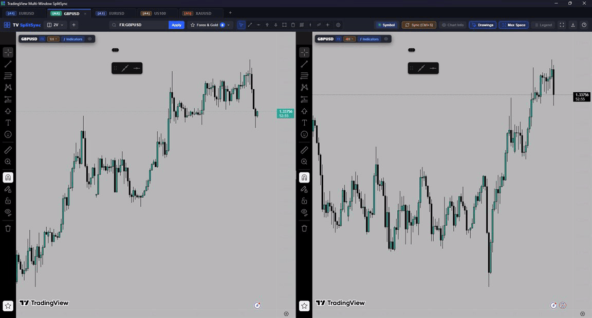

# MultiChart-TradingView 🚀
### Professional Multi-Window & Multi-Chart TradingView Desktop Terminal
### ترمینال پیشرفته دسکتاپ چند پنجره‌ای و چند چارته تریدینگ‌ویو با همگام‌سازی سراسری

---

## 🌐 English Documentation

### 📌 Overview
**MultiChart-TradingView** is a standalone Windows desktop terminal for active traders and technical analysts. It puts many TradingView charts on one screen — or across several monitors — and keeps the crosshair, the time axis, the symbol and the drawings synchronised between them, **without paid subscription layout locks and without browser extensions**. It is a single native executable: Rust on the outside, a WebView2 chart page per pane.

### ✨ Key Features
* 🖥️ **Multi-window, multi-monitor workspace (`Ctrl+N`):**
  * Open as many independent terminal windows as you need and spread them over 2, 3 or more physical monitors.
  * Each window keeps its own layout, its own charts and its own synchronised drawings.
* 🎯 **Zero-latency crosshair and time synchronisation:**
  * Moving the pointer in any pane mirrors the vertical line and the exact timestamp onto every other chart, in every pane and window.
  * Timestamp matching keeps candles aligned across different timeframes (1m, 15m, 1H, 4H, 1D…).
* 🔀 **48 split layouts, from one chart to a 16-pane grid:**
  * 1, 2 (vertical / horizontal), 3 (rows, columns, dominant side, dominant top or bottom), 4 (grid, rows, columns, mixed), 5, 6, 7, 8, 9, 10, 12 and 16 panes.
  * The layout picker is in the master bar and shows a thumbnail of every arrangement.
  * Smooth draggable splitters; double-click a splitter to snap back to an even ratio.
* 👤 **Up to 8 TradingView accounts side by side:**
  * Each account tab runs in its own browser profile, so sessions, layouts and drawings never leak between accounts.
  * Switch tabs with `Ctrl+Tab`, open a new one with `Ctrl+T`, close with `Ctrl+W`.
* 🛠️ **Floating, customisable drawing master bar:**
  * One shared toolbar for your favourite drawing tools — trend line, horizontal line, arrow marks, fib retracement, brush, text, gann box, long/short position and more.
  * Choose exactly which tools the bar shows so it stays short.
  * A tool armed from the master bar belongs to the tab you clicked it on and to the one drawing you are making — it does not follow you across every chart.
* 🔍 **Live symbol search and watchlist:**
  * Type a ticker and get results from every connected broker and exchange, each badged with its venue (Binance, OANDA, FXCM, CME, Bitstamp, Vantage…).
  * Apply a symbol to all linked charts in one click, with a persistent watchlist for fast switching.
* 📊 **Chart clarity controls in the master bar:**
  * **Symbol** sync toggle, **Chart Info**, **Drawings** (cloud save with `Ctrl+S`), **Max Space** (strips TradingView chrome so the candles own the screen), **Legend** (show or hide the indicator values on every chart).
* 🔄 **In-app updates:**
  * The **Update** button checks the newest GitHub release against the version you are running and flags itself when something newer exists.
  * It lists the packages for this platform — installer, MSI or portable zip — with their size and whether a checksum was published, and downloads with a live progress bar.
  * **Nothing is executed until the SHA-256 of the download matches the published checksum**; a mismatch deletes the file and says so. When you are already on the newest release the panel simply says so.
* 🔐 **Account and cloud sync:**
  * Direct Google sign-in plus a browser-authorised login path, with sessions preserved between runs.
  * Drawings, indicators, templates and chart settings persist per account.
* ⚡ **Clean by default:**
  * No sidebars, no promotional banners, no bottom clutter — the screen belongs to the charts.

### ⌨️ Keyboard Shortcuts
| Shortcut | Action |
| :--- | :--- |
| `Ctrl + N` | Open a new independent terminal window |
| `Ctrl + T` / `Ctrl + W` | New account tab / close the current tab |
| `Ctrl + Tab` | Cycle between account tabs |
| `Ctrl + S` | Save drawings to the TradingView cloud account |
| `F11` | Toggle fullscreen |
| `Enter` (in search) | Apply the symbol to all linked charts |
| `Esc` | Close the open menu or panel |
| `Double-click splitter` | Reset that divider to an even ratio |

### ⚡ Performance & Specifications
| | |
| :--- | :--- |
| **Portable download** | **3.4 MB** (ZIP) |
| **Terminal executable** | **8.4 MB**, one file, no dependencies |
| **Terminal process** | **~27 MB** of its own memory |
| **Per chart** | **~250 MB** — that is TradingView's own web runtime, not the terminal |
| **Startup** | Under half a second to the first chart |
| **Architecture** | Rust + Tauri v2, one WebView2 page per chart pane |
| **Requires** | Windows 10 or 11, x64. No admin rights for the portable build |

### 📥 Download & Installation
1. Open the [Releases](https://github.com/XUtility/MultiChart-TradingView/releases/latest) page.
2. Pick one of:
   * `MultiChart-TradingView-<version>-Portable.zip` — unzip anywhere and run `MultiChart-TradingView.exe`.
   * `MultiChart-TradingView_<version>_x64-setup.exe` — NSIS installer (per-user, no elevation prompt).
   * `MultiChart-TradingView_<version>_x64_en-US.msi` — MSI for managed machines.
3. From then on, keep the terminal current with the **Update** button inside the app.

*Sign-in, layouts and drawings are stored under your Windows user profile, so the same account state is reused by the portable and the installed build.*

---

## 🇮🇷 راهنمای فارسی

### 📌 معرفی
**MultiChart-TradingView** یک ترمینال دسکتاپ مستقل و فوق‌سریع برای ویندوز است که چندین چارت تریدینگ‌ویو را روی یک صفحه (یا چند مانیتور) می‌چیند و خط نشانگر، زمان، نماد و رسم‌ها را بین همه آن‌ها همگام نگه می‌دارد — **بدون نیاز به اشتراک‌های دلاری و بدون هیچ اکستنشن مرورگر**. خروجی برنامه یک فایل اجرایی نیتیو است: بدنه با Rust و هر چارت در یک WebView2 مستقل.

### 🌟 قابلیت‌های کلیدی
* 🖥️ **چند پنجره و چند مانیتور (`Ctrl+N`):** هر تعداد پنجره مستقل باز کنید و چارت‌ها را بین مانیتورها پخش کنید.
* 🎯 **سینک بلادرنگ خط نشانگر و زمان:** حرکت ماوس روی هر چارت، خط عمودی و زمان دقیق را روی همه چارت‌ها و تایم‌فریم‌های دیگر می‌اندازد.
* 🔀 **۴۸ چیدمان، از تک‌چارت تا گرید ۱۶ خانه‌ای:** ۱، ۲، ۳، ۴، ۵، ۶، ۷، ۸، ۹، ۱۰، ۱۲ و ۱۶ چارت با پیش‌نمایش بصری در نوار بالا؛ خطوط تقسیم قابل کشیدن و با دابل‌کلیک روی حالت برابر برمی‌گردند.
* 👤 **تا ۸ حساب تریدینگ‌ویو همزمان:** هر تب حساب پروفایل مرورگر مستقل خودش را دارد تا نشست، چیدمان و رسم‌ها قاطی نشود.
* 🛠️ **نوار ابزار رسم شناور و شخصی‌سازی‌شدنی:** خط روند، افقی، پیکان، فیبوناچی، براش، متن، گن باکس و پوزیشن معاملاتی؛ فقط ابزارهای مورد علاقه‌تان را روی نوار نگه دارید. ابزاری که انتخاب می‌کنید فقط به همان تب و همان رسم مربوط است و به بقیه چارت‌ها سرایت نمی‌کند.
* 🔍 **جستجوی زنده نماد + واچ‌لیست:** نتایج همه بروکرها و صرافی‌ها با برچسب نام آن‌ها، و اعمال نماد روی همه چارت‌های متصل با یک کلیک.
* 📊 **دکمه‌های نمایش روی نوار بالا:** Symbol، Chart Info، Drawings (ذخیره ابری با `Ctrl+S`)، Max Space (حذف تمام عناصر اضافی تریدینگ‌ویو) و Legend (نمایش/مخفی‌سازی مقادیر اندیکاتورها).
* 🔄 **آپدیت از داخل برنامه:** دکمه Update آخرین ریلیز گیت‌هاب را با نسخه فعلی مقایسه می‌کند، بسته مناسب را با نوار پیشرفت دانلود می‌کند و **تا SHA-256 فایل با چک‌سام منتشرشده مطابقت نکند هیچ چیز اجرا نمی‌شود**؛ اگر به‌روز باشید همین را اعلام می‌کند.
* 🔐 **ورود به حساب و همگام‌سازی ابری:** ورود با گوگل یا مرورگر، و ماندگاری نشست، رسم‌ها، اندیکاتورها و تنظیمات هر حساب.
* ⚡ **محیط تمیز:** بدون سایدبار، تبلیغ و شلوغی — کل صفحه مال چارت‌هاست.

### ⌨️ کلیدهای میانبر
| میانبر | عملکرد |
| :--- | :--- |
| `Ctrl + N` | پنجره ویندوزی جدید و مستقل |
| `Ctrl + T` / `Ctrl + W` | تب حساب جدید / بستن تب فعلی |
| `Ctrl + Tab` | جابه‌جایی بین تب‌های حساب |
| `Ctrl + S` | ذخیره رسم‌ها در فضای ابری تریدینگ‌ویو |
| `F11` | تمام‌صفحه |
| `Enter` (در کادر جستجو) | اعمال نماد روی چارت‌های متصل |
| `Esc` | بستن منو یا پنل باز |
| `دابل‌کلیک روی خط تقسیم` | بازگشت به نسبت برابر |

### 🚀 دانلود و اجرا
1. به صفحه [Releases](https://github.com/XUtility/MultiChart-TradingView/releases/latest) بروید.
2. یکی را انتخاب کنید:
   * فایل **Portable zip** (حدود ۳٫۴ مگابایت) را استخراج کنید و `MultiChart-TradingView.exe` را اجرا کنید — بدون نصب و بدون دسترسی ادمین.
   * یا نصب‌کننده `setup.exe` / فایل `msi`.
3. برای به‌روزرسانی‌های بعدی از همان دکمه **Update** داخل برنامه استفاده کنید.

---

## 📜 License & Copyright
**Copyright (c) 2026 XUtility. All rights reserved.**

This software is **Proprietary**. You are authorized to download, execute, and use the binary releases of this software for personal and professional trading purposes. Decompilation, reverse engineering, redistribution, or unauthorized modification of the code is strictly prohibited. For inquiries, please refer to the [LICENSE](LICENSE) file or contact the repository maintainers.
